 

## About

BSc in Computer Science & Engineering at East West University, Bangladesh. I turn product ideas into working systems: from the first sketch in Figma to a shipped, polished release.

## Projects

## Stack

## Telemetry

## Repositories

<a href="https://github.com/md-mahfujur-rahman-sujel/Apex-Arcade" target="_blank" rel="noopener noreferrer"><b>Apex-Arcade</b></a> ·
<a href="https://github.com/md-mahfujur-rahman-sujel/Unrot" target="_blank" rel="noopener noreferrer"><b>Unrot</b></a> ·
<a href="https://github.com/masum-mir/Oppzy" target="_blank" rel="noopener noreferrer"><b>Oppzy</b></a>

## Activity stream

<a href="https://github.com/md-mahfujur-rahman-sujel" target="_blank" rel="noopener noreferrer">full contribution graph on GitHub ↗</a>

East West University · Bangladesh · <a href="https://github.com/md-mahfujur-rahman-sujel" target="_blank" rel="noopener noreferrer">github.com/md-mahfujur-rahman-sujel</a>

